  And they praised God because of me.

<h2 align="left">
  안녕하세요! 
  어제보다 더 나은 내일을 만드는 프론트엔드 개발자 김이레입니다.
</h2>

  TypeScript와 프론트엔드를 중심으로, 아이디어를 실제로 작동하는 제품으로 만듭니다. 
  AI로 문제를 푸는 방법을 넓히고, 작은 불편을 발견해 더 나은 사용자 경험으로 바꾸는 일을 좋아합니다. 
  어제보다 더 나은 코드를, 그리고 오늘보다는 더 나은 내일을 만듭니다.

 

  

<picture>
  <source
    media="(prefers-color-scheme: dark)"
    srcset="https://raw.githubusercontent.com/elroi773/elroi773/output/pacman-contribution-graph-dark.svg"
  />
  <source
    media="(prefers-color-scheme: light)"
    srcset="https://raw.githubusercontent.com/elroi773/elroi773/output/pacman-contribution-graph.svg"
  />
  
</picture>
